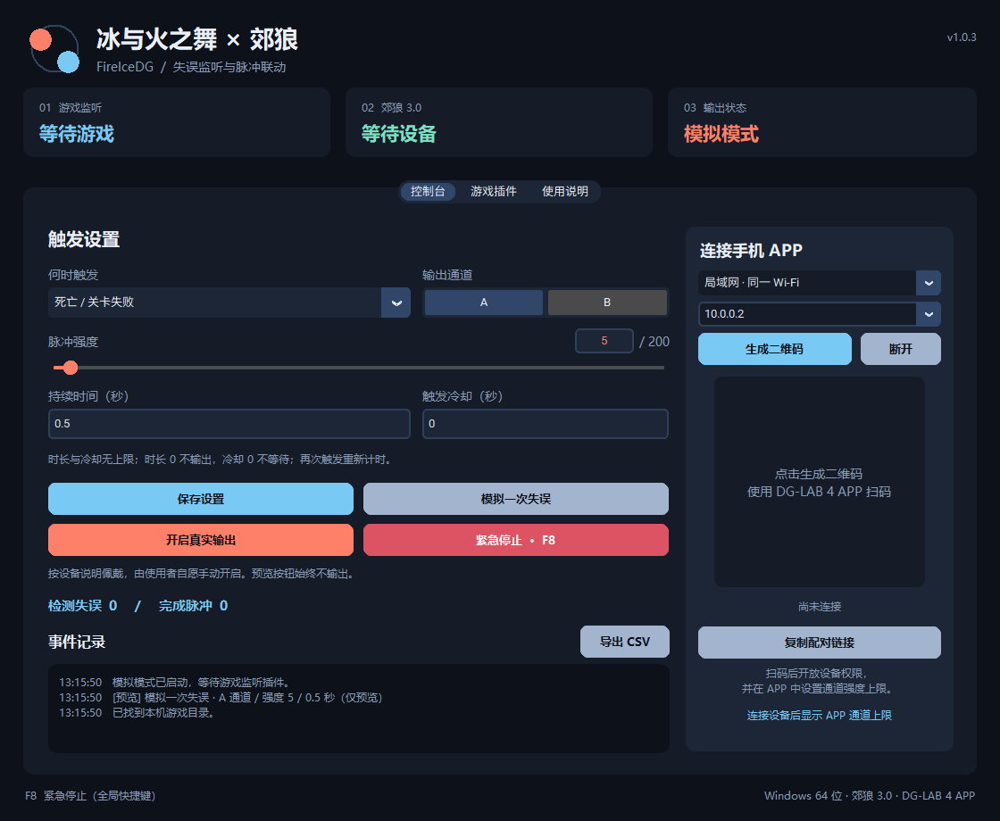

# FireIceDG · 冰与火之舞 × 郊狼

Windows 桌面软件：监听 **A Dance of Fire and Ice** 的失误，通过 **DG-LAB 4 APP** 联动 **郊狼 3.0**。

## 下载运行

前往 [Releases](https://github.com/XiGuaOhh/FireIceDG/releases) 下载 `FireIceDG-v1.0.3-Windows.zip`，解压后双击 `FireIceDG.exe`，无需安装 Python。也可单独下载 EXE。



## 功能

- 游戏插件直接报告关卡失败、过早、过晚、漏按、多按和非纯完美判定。
- 中文界面，支持局域网二维码和 DG-LAB V4 公网中继配对。
- A / B 通道选择、强度 0–200、APP 通道上限显示。
- 持续时间与触发冷却独立设置，没有软件上限；时长 0 不输出，冷却 0 不等待。
- 再次触发替换当前脉冲并重新计时，强度不叠加。
- 默认模拟模式，手动开启真实输出；F8 全局急停，断连后需手动重新开启。
- 自动识别现有 BepInEx 5 / Unity Mod Manager，记录安装文件并支持卸载。

## 开始使用

1. 退出游戏，在软件「游戏插件」页安装监听插件，再启动游戏。
2. 在 DG-LAB 4 APP 中连接郊狼 3.0，扫码配对并开放设备。
3. 先以模拟模式游玩，确认软件能记录失误。
4. 保存通道、强度、时长和冷却设置，手动开启真实输出。

详细说明见 [开始使用](开始使用.md)，变更见 [更新记录](更新记录.md)。

## 兼容与验证范围

适用于 Windows 64 位 Mono 版游戏、郊狼硬件 3.0 和 **DG-LAB 4 APP / V4 Socket 协议**。旧版 APP 的 V3 Socket 协议不受支持。

桌面程序版本为 **1.0.3**，随附监听插件为 **1.0.1**。插件曾在开发机游戏中验证加载与认证事件接收；本轮 48 项自动检查中 47 项通过，1 项本机 UDP 自检因环境收发超时跳过，因此本次发布尚未重新确认游戏到软件的实机通信。所有设备输出检查使用模拟 APP，尚未验证真实设备输出。

## 源码与打包

完整 Python 程序、C# 插件源码、插件测试和第三方许可在 [`source/`](source/)。源码运行与插件构建方法见 [开发说明](source/README.md)。

在 Windows Python 3.12 环境安装依赖后，可重新打包：

```powershell
python -m pip install -r source/requirements.txt
python -m pip install pyinstaller==6.21.0
python scripts/build_windows.py
```

生成的 EXE 与 ZIP 位于 `dist/`。不包含游戏程序集、用户设置或配对密钥。

## 许可与第三方组件

本项目暂未指定开源许可证。公开源码不改变作者对项目的权利；第三方组件继续适用各自许可证。组件来源与许可文本见 [第三方组件](第三方组件.md) 和 [`source/assets/licenses/`](source/assets/licenses/)。
